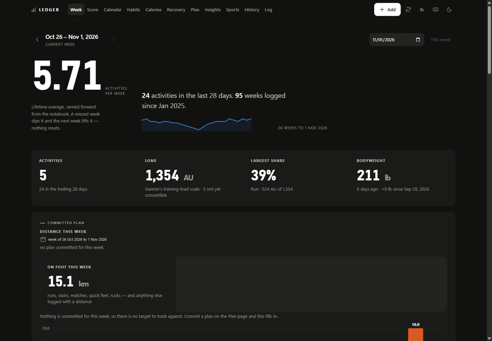
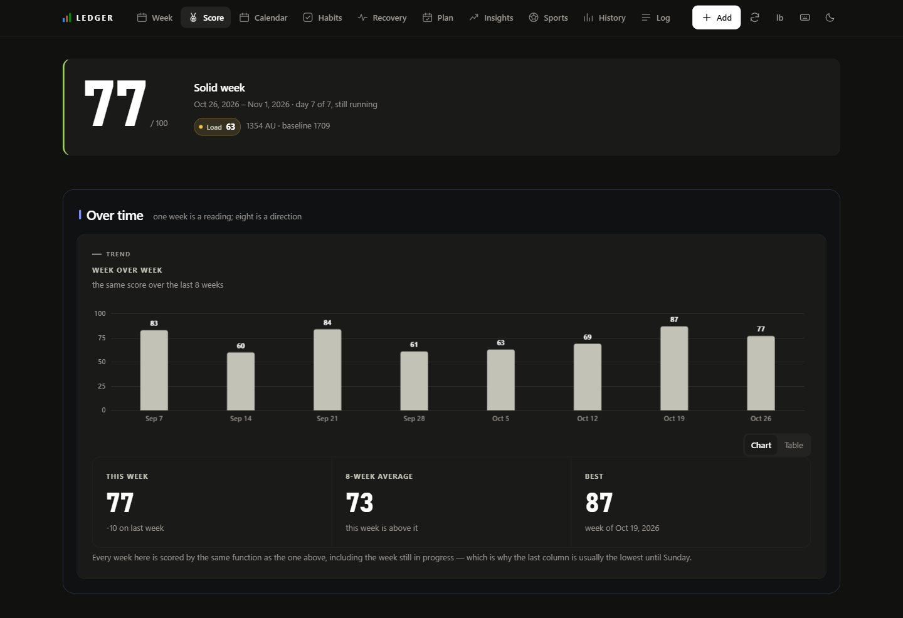
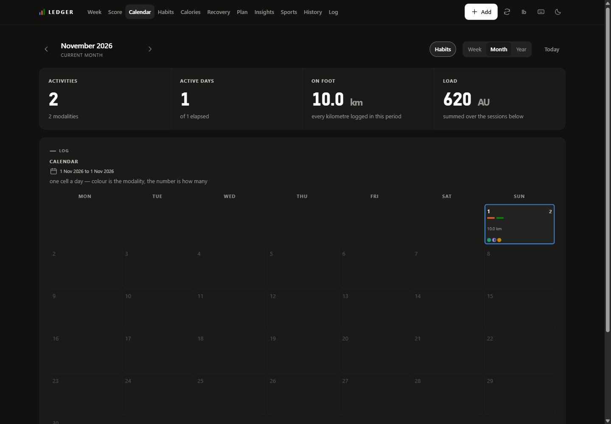
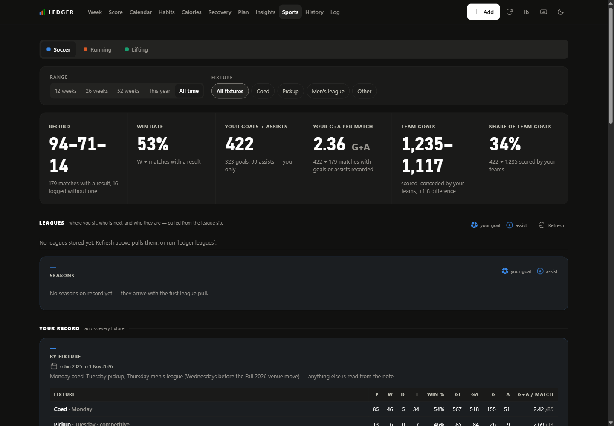

# Ledger

A personal training log that runs on your own machine. It replaces a paper
notebook, pulls what a Garmin watch measures well (runs, rides, matches,
sleep, heart-rate variability, resting heart rate), and answers the question
most fitness apps dodge: **how much training did I actually do this week,
across every sport, on one scale?**

It is built for one person. No accounts, no sign-in, no cloud — the app lives
on a computer at home and is reached over the home network or a private
network such as Tailscale. See [docs/BRIEF.md](docs/BRIEF.md) for the design
brief and the things it deliberately does not do.

## What it looks like









The numbers above are invented: `scripts/demo_data.py` builds a demo
database, which is also the quickest way to try the app without a Garmin
account (`LEDGER_DB_PATH=data/demo.db uvicorn ledger.api.main:app`).

## What it shows

| Page | What it answers |
|---|---|
| **Week** | What happened this week, and how it compares with recent weeks |
| **Score** | A week grade and a lifetime level — the one place the app judges anything |
| **Calendar** | Every day at a glance |
| **Habits** | Did the small daily things happen |
| **Recovery** | Sleep, HRV, resting heart rate, readiness and stress from the watch, read against your own ranges, and what they have to do with the training |
| **Plan** | How far to run next week, and the weeks after |
| **Insights** | What the record says about itself |
| **Sports** | Soccer, running and lifting, each in its own detail |
| **History** | Every week since the start, and a free-form explorer |
| **Log** | Find one session and edit it |

Everything is a plain web page served by the app; there is nothing to install
on a phone beyond adding the page to the home screen.

## Principles

- **No streaks.** A missed day lowers a rolling count; it never resets one.
- **Rolling windows only.** "Last 28 days" rather than "this month".
- **Load is one scale.** Every session, whatever the sport, is scored as
  effort × minutes (Foster's session-RPE), so a match and a run add up.
- **Heuristics are shown as heuristics.** The acute:chronic ratio is a
  position on a scale, never an alarm.
- **Colour is a reading on a published scale, not a verdict** — Garmin's own
  bands for Garmin's scores, your own range for HRV, your own sleep need for
  sleep.

## Quick start

You need Python 3.12 and a Garmin Connect account.

```sh
cp .env.example .env          # fill in GARMIN_EMAIL / GARMIN_PASSWORD
python -m venv .venv && .venv/Scripts/pip install -e ".[dev]"

ledger init                   # create the database, apply migrations
ledger garmin-login           # once, interactively — prompts for MFA if enabled
ledger sync                   # pull the last 3 days from Garmin
ledger add week.txt           # bulk-enter notebook sessions (see docs/NOTEBOOK.md)
uvicorn ledger.api.main:app   # then open http://127.0.0.1:8000
```

Or with Docker, which also runs the nightly sync and backup:

```sh
docker compose up -d
docker compose run --rm cli ledger garmin-login   # one-time, interactive
```

Ports bind to `127.0.0.1` by default. `LEDGER_BIND=0.0.0.0` in `.env` opens
the app to the rest of the home network. There is **no login**, by design, so
anyone on that network can read and write the whole record. Keep it on a
private network; never port-forward it to the internet.

### Optional: league tables

If you play in an amateur league that publishes its table on ezleagues or
through the DaySmart "Dash" app, the Soccer page can show standings, the next
fixture and the opponent's form. Set the provider details in `.env` (see
`.env.example`); leave them unset otherwise.

## Layout

```
ledger/
  config.py            environment -> Config. No config file, no settings table.
  cli.py               init, garmin-login, sync, backfill, add, rpe, report, leagues
  entry.py             bulk-entry grammar for notebook pages (docs/NOTEBOOK.md)
  ingest.py            persist a session, then score PRs
  leagues.py           league tables and fixtures from ezleagues and DaySmart
  db/
    migrations/        001..016, append-only — never edited in place
    schema.py          connection pragmas + migration runner
    queries.py         every SQL statement in the project
  core/                pure, no I/O, heavily tested
    e1rm.py            Epley, working sets only, <=10 reps
    prs.py             four PR kinds
    load.py            session RPE, ACWR
    windows.py         rolling aggregations — no streaks, ever
  garmin/
    client.py          auth, token resume, pacing, backoff
    sync.py            nightly job; defensive, idempotent, always logs
    mapping.py         activity type -> kind, response parsing
  report/              the server-side arithmetic behind every page
  api/main.py          FastAPI: serves the web app and its endpoints
  web/                 the web app — vanilla ES modules, no build step, no npm.
                       Has its own README.md; read it before changing anything there
docs/
  BRIEF.md             the design brief and its non-goals
  NOTEBOOK.md          what a paper log looks like and how to transcribe one
  DATA-MAP.md          which screens depend on which data fields
notebook/              your photos and transcriptions of the paper log (gitignored)
scripts/               nightly sync, verified SQLite backup, front-end audits
tests/
```

## Things worth knowing before changing anything

**The schema follows the notebook, not the original brief.** The brief assumed
a barbell log. A real training log turned out to be soccer, running, cycling,
fasting and rep-count lifting with no weight × reps anywhere;
`002_notebook_reality.sql` adapts the schema and `docs/NOTEBOOK.md` explains
why. The e1RM and PR code is built and tested but idle until barbell work is
logged.

**No streaks.** `core/windows.py` is rolling-window only. A missed day dips a
count; it never resets one. There is a test asserting exactly this.

**The Garmin library is pinned to the 0.2 line, and moving it is a login.**
0.3 replaced the OAuth1 session with a token minted by a password login, and
Garmin's SSO has been answering that login with 401 for some accounts while
the OAuth1 tokens 0.2 resumes from keep working. The pin stays at 0.2 until
a 0.3 login succeeds here; `pyproject.toml` says what to do then. Whichever
line is installed, crossing between them means `ledger garmin-login` once from
a terminal, then a rebuild: the two token formats cannot be converted.

**Passwords with `$` or quotes in `.env`** reach the container intact only
because `docker-compose.yml` reads the file in raw mode. Without it compose
interpolates `$name` and strips quotes, and Garmin answers 401 to a password
that is right in the file.

**Rate limiting is not optional.** Every Garmin call goes through
`GarminClient.call()`, which paces to 2.5 s and backs off on 429/5xx. Garmin's
API is unofficial and blocks accounts that hammer it. Do not add a code path
that bypasses it, and do not lower the delay to make a backfill finish sooner.

**Weights are kilograms internally, always.** Display unit is configuration.
A notebook written in pounds keeps `week.bodyweight_lbs` as written so a
transcribed page can be checked against its photo.

**Dates are local `YYYY-MM-DD` strings and aggregation happens on the string.**
Converting to UTC misattributes late-evening sessions to the next day.

**Every screen is indexed.** `docs/DATA-MAP.md` lists which panels read which
fields; `scripts/inventory.py --check` fails when a panel is missing from it.
`scripts/qa.py` drives every page in both themes and both viewports and fails
on overlap, clipped text, empty panels, unlabelled periods, low contrast and
small tap targets.

## Contributing

Ledger is a single-user app published as open source. Two rules for anything
that lands in this repository:

- **Nothing personal.** No real training data, names, teams, venues, towns,
  health details or weights in code, tests, docs or screenshots. Fixtures
  use invented names; screenshots come from `scripts/demo_data.py`; anything
  particular to one person or venue is configuration in `.env`.
- **Nothing secret.** Credentials, tokens, databases and the `notebook/`
  folder stay gitignored. If you think something sensitive has been
  committed, open an issue saying only that — not what it was.

## Development

```sh
.venv/Scripts/python -m pytest
.venv/Scripts/python -m ruff check .
.venv/Scripts/python scripts/qa.py          # front-end rendering audit (needs the app running)
.venv/Scripts/python scripts/inventory.py --check
```

Tests cover the things that are painful to get wrong and hard to notice: load
and e1RM arithmetic, PR detection, rolling windows, Garmin response parsing,
sync idempotency, league-season discovery. Glue code is deliberately untested.

## Reading it from Claude

`ledger/mcp/` serves the read API as MCP tools, so a Claude session on
the same machine can ask about a week, a session, the watch's nightly numbers
or the sync without opening the app. It is a proxy over the running app:
every tool is one GET, nothing is computed twice, and the number quoted in a
chat is the number on the screen. Read-only. The Scoreboard is deliberately
not exposed.

```sh
pip install -e ".[mcp]"
.venv/Scripts/python.exe -m ledger.mcp       # stdio; the app must be up
```

Register it as a stdio server with that command, in Claude Code (`claude mcp
add -s user ledger -- <path-to-venv-python> -m ledger.mcp`) or in
Claude Desktop's `claude_desktop_config.json`. `LEDGER_URL` points it at an
app that is not on `http://127.0.0.1:8000`. `--transport http --port N` serves
the same tools on a loopback port for a client that needs one; it binds
127.0.0.1 only.
